 

 

---

## 👨‍💻 Tentang Saya

Halo, saya **Eka Aji Pramudia**, dikenal sebagai **Kaaji**, dari Makassar, Indonesia.

Saya tertarik pada dunia pengembangan produk digital, terutama di bagian **UI/UX Design, perancangan tampilan, dan pengembangan website**.

Saya suka memikirkan bagaimana sebuah tampilan seharusnya bekerja, bukan hanya bagaimana tampilannya terlihat. Mulai dari menyusun layout, menentukan alur interaksi, memikirkan pengalaman pengguna, sampai menghubungkan setiap elemen antarmuka dengan logika dan fungsi di baliknya.

Bagi saya, desain dan development bukan dua hal yang terpisah. Keduanya harus saling terhubung agar menghasilkan produk yang tidak hanya menarik secara visual, tetapi juga nyaman dan benar-benar berfungsi.

---

## 🌐 Ekosistem Kaami

**[Kaami](https://kaami.my.id)** menjadi tempat untuk mengembangkan dan mengelola berbagai karya serta produk digital saya.

<table>
<tr>
<td width="50%" valign="top">

### 🌐 Kaami

Website utama dan wadah berbagai karya serta pengembangan produk digital.

[**Kunjungi →**](https://kaami.my.id)

</td>
<td width="50%" valign="top">

### 💌 Undangan

Platform undangan digital dengan tampilan yang dirancang agar menarik, responsif, dan mudah dibagikan.

[**Kunjungi →**](https://kaami.my.id/undangan)

</td>
</tr>
<tr>
<td width="50%" valign="top">

### 💼 Portfolio

Website pribadi untuk menampilkan karya, eksperimen, dan perjalanan pengembangan saya.

[**Kunjungi →**](https://kaajiitsme.github.io)

</td>
<td width="50%" valign="top">

### 👤 ProfileKM

Eksperimen profil digital dalam ekosistem Kaami.

*Sementara tidak aktif.*

</td>
</tr>
</table>

> 🔒 Source code Kaami dan Undangan Digital bersifat private.

---

## 🎨 Fokus & Ketertarikan

Hal yang paling saya nikmati dalam mengembangkan produk digital adalah proses menghubungkan desain dengan fungsionalitas.

<table>
<tr>
<td width="50%" valign="top">

### UI/UX & Visual Interface

- Merancang tampilan antarmuka.
- Menyusun layout dan hierarki visual.
- Memikirkan pengalaman serta alur pengguna.
- Membuat desain responsif.

</td>
<td width="50%" valign="top">

### Design Thinking

- Memikirkan bagaimana pengguna berinteraksi.
- Menentukan struktur dan navigasi.
- Memecahkan masalah melalui desain.
- Menyederhanakan pengalaman penggunaan.

</td>
</tr>
<tr>
<td width="50%" valign="top">

### Interface Development

- Mengubah desain menjadi antarmuka nyata.
- Menghubungkan komponen dan interaksi.
- Mengembangkan website dan aplikasi.
- Menyesuaikan tampilan berbagai perangkat.

</td>
<td width="50%" valign="top">

### System & Functionality

- Menghubungkan frontend dengan backend.
- Mengembangkan logika dan alur sistem.
- Mengintegrasikan API dan database.
- Memastikan fitur bekerja sesuai kebutuhan.

</td>
</tr>
</table>

---

## ⚙️ Tech Stack

Tools dan teknologi yang saya gunakan dalam proses desain, pengembangan, dan eksperimen.

---

## 📌 Open Source

Beberapa proyek dan eksperimen yang tersedia secara publik di GitHub.

| Proyek | Deskripsi | Stack |
|---|---|---|
| [**Portfolio**](https://github.com/KaajiItsMe/KaajiItsMe.github.io) | Website portfolio pribadi |  |
| [**ToDo**](https://github.com/KaajiItsMe/ToDo) | ToDoTask, aplikasi pengingat |  |
| [**game-nuxt**](https://github.com/KaajiItsMe/game-nuxt) | Eksperimen game berbasis Nuxt |  |
| [**CursorHide**](https://github.com/KaajiItsMe/CursorHide) | Utilitas untuk menyembunyikan kursor |  |

---

## 📊 Statistik & Aktivitas

  

---

## 📫 Temukan Saya

  

*Designing interfaces, connecting ideas, and building things that work.*

Dibuat dengan ❤️ oleh <a href="https://github.com/KaajiItsMe">Kaaji</a>

